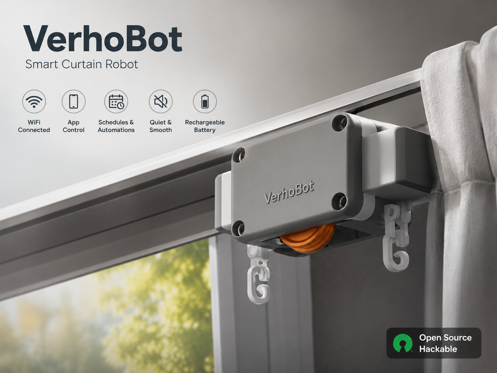
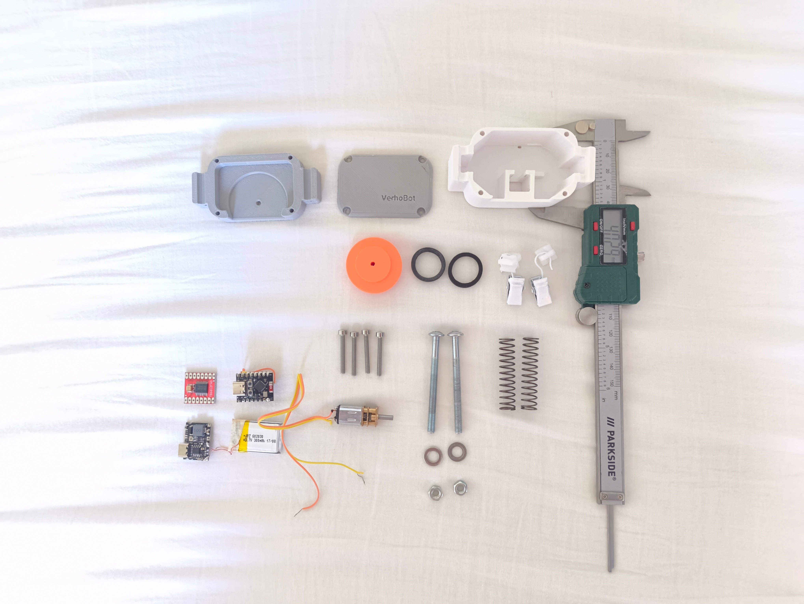
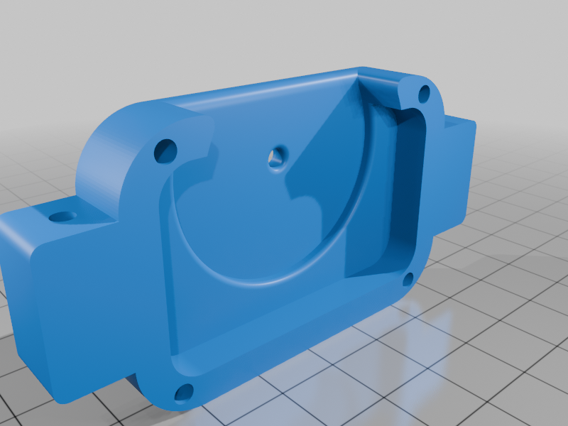
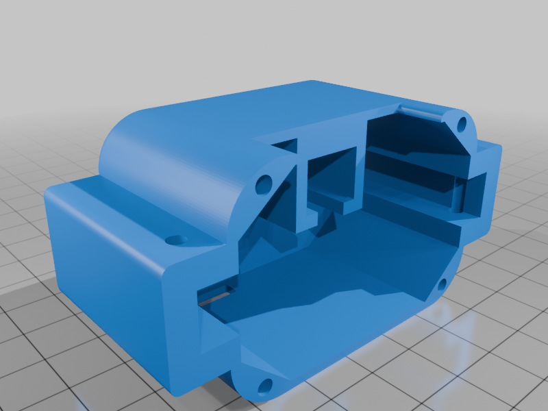
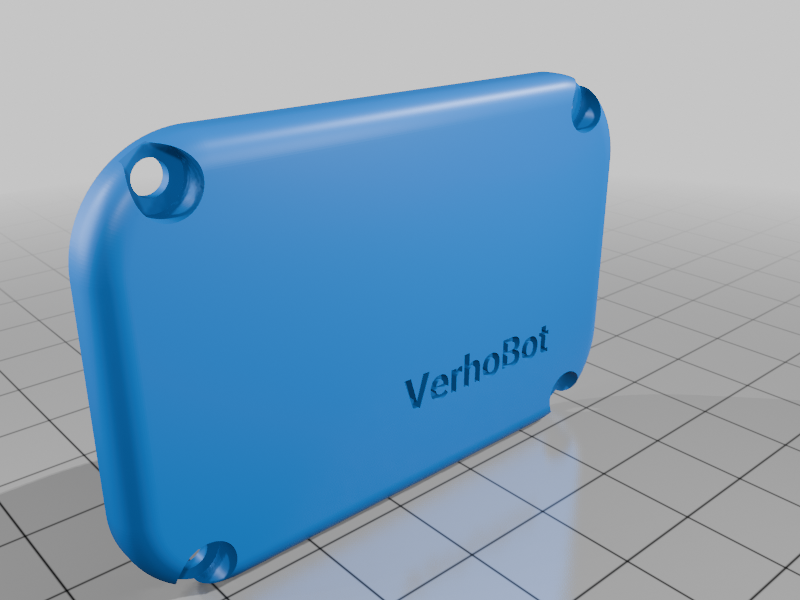
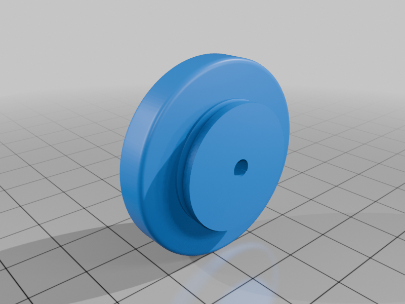

<div align="center">



# VerhoBot · Hardware & CAD

**The 3D-printable body, the drive wheel, and the electronics that live inside.**

*Sleep in darkness. Wake up with sunlight.*

[](https://certification.oshwa.org/)
[](LICENSE.txt)
[](#-the-parts)
[](#-electronics)
[](https://www.thingiverse.com/thing:7370927)

[**Firmware flasher**](https://myworks.gt.tc/verhobot/) · [**Thingiverse**](https://www.thingiverse.com/thing:7370927) · [**Build video**](https://www.youtube.com/watch?v=6-GEg8fdRDQ) · [**Mechanical design video**](https://www.youtube.com/watch?v=YXQe8-dixHU)

</div>

---

## 📐 At a glance

VerhoBot clips onto an ordinary curtain rail and drives itself along it with a single geared motor. Everything mechanical is printable on a hobby FDM printer. Four printed parts, a handful of fasteners, and a small N20 motor are all it takes.

| | |
|---|---|
| **Printed parts** | 4 (front plate, back housing, cover, drive wheel) |
| **Overall envelope** | 80 × 40 mm footprint |
| **Drive** | N20 geared motor → 35 mm wheel with O-ring tyres |
| **Fasteners** | 4 × small cap screws (cover), 2 × long bolts with nuts and washers, 2 × compression springs |
| **Mounting** | Rides on the rail, curtain hangs from standard curtain hooks |
| **Brains** | ESP32-C3 SuperMini, TB6612FNG, LiPo + USB-C charging |

---

## 🧩 The parts

<div align="center">

<br><sub>Everything in one frame — printed parts, electronics, fasteners, hooks.</sub>
</div>

<br>

All files are binary STL, in millimetres, in the `files/` folder. Dimensions below are the measured bounding box of each model.

| Part | File | Size (mm) | Preview |
|---|---|---|---|
| **Front plate**: carries the wheel recess and the mounting ears | [`VerhoBot_-_front.stl`](files/VerhoBot_-_front.stl) | 80 × 11 × 40 |  |
| **Back housing**: compartments for the battery, motor, and PCB | [`VerhoBot_-_back.stl`](files/VerhoBot_-_back.stl) | 80 × 37.8 × 40 |  |
| **Cover**: debossed *VerhoBot* lid, four-screw closure | [`cover_face_-_Part_1.stl`](files/cover_face_-_Part_1.stl) | 60 × 4 × 40 |  |
| **Drive wheel**: 35 mm wheel that grips the rail (orange in the photos) | [`VerhoBot_-_Part_1_1.stl`](files/VerhoBot_-_Part_1_1.stl) | 35 × 13 × 35 |  |

### Suggested print settings

> A starting point rather than a rule — tune for your printer.

- **Material:** PLA works fine; PETG if the rail sits in a sunny window.
- **Layer height:** 0.2 mm
- **Walls:** 3–4 perimeters on the housings (the screw bosses take real load)
- **Infill:** 20–25%
- **Supports:** check the back housing orientation in your slicer; it has internal compartments
- **Drive wheel:** print it solid and let the **O-rings provide the grip**; no need for a soft filament

---

## 🔧 Bill of materials

### Mechanical

| Qty | Item | Notes |
|---|---|---|
| 1 | Front plate, back housing, cover, drive wheel | Printed from [`files/`](files/) |
| 2 | O-rings | Fit the wheel as tyres |
| 2 | Compression springs | See the parts photo |
| 4 | Small cap screws | Cover closure |
| 2 | Long bolts + nuts + washers | See the parts photo |
| 2+ | Curtain hooks / glider clips | Standard rail hooks |

### Electronics (V1, proven)

| Qty | Item | Notes |
|---|---|---|
| 1 | ESP32-C3 SuperMini | Main controller, Wi-Fi |
| 1 | TB6612FNG motor driver | Only channel A is used |
| 1 | N20 geared DC motor | Recommended: **100 RPM, 6 V**, a good speed/torque balance |
| 1 | TP4056 charging module | USB-C LiPo charging |
| 1 | 3.7 V LiPo | Recommended: **~300 mAh** |
| 1 | MT3608 boost converter | *Optional*: only if your charger module has no built-in boost |

---

## 🔌 Electronics

The V1 build wires off-the-shelf modules together inside the housing. **V2 replaces that stack with a single custom board** so the whole thing gets smaller, cleaner, and easier to assemble.

<div align="center">

<br><sub><b>VerhoBot V2, rev 0.2</b>: 3D render. The SuperMini plugs into the header row; USB-C, a tactile switch, test points, and the driver and power stages are all on-board.</sub>
</div>

<br>

| Generation | Status | What it is |
|---|---|---|
| **V1** | ✅ Fully functional | ESP32-C3 SuperMini + TB6612FNG + TP4056 modules, hand-wired |
| **V2** | 🛠️ In development (rev 0.2) | One custom PCB, same functionality, designed to fit the housing |

Schematics and board renders live one level up in [`../`](../): [V1 schematic](../verhoBotV1_schematic.png), [charging circuit](../verhoBot_charging.png), and the [earlier PCB render](../VerhoBot_3D_PCB1.0.png).

### Hardware notes worth knowing

- **Wake-from-sleep pin:** the ESP32-C3 can only wake from *deep* sleep on **GPIO0–5**. The onboard BOOT button (GPIO9) cannot do it, so a wake button has to go on a separate pin. VerhoBot uses **GPIO1**, which is free of the motor-driver and battery-sense pins.
- **Power LED:** the always-on red LED on many SuperMini boards sits straight on the power rail. It stays lit in deep sleep and costs real battery life, so removing it (or its series resistor) is a worthwhile mod for a battery-powered build.
- **Nudge-to-wake** *(roadmap)*: using the motor's back-EMF as a wake trigger, so a gentle push on the curtain wakes the bot with no button. It needs a small rectifier and comparator front-end to produce the clean digital level deep-sleep wake requires.

---

## 🛠️ Assembly overview

> A high-level map, not a step-by-step. The [build video](https://www.youtube.com/watch?v=6-GEg8fdRDQ) shows each stage in detail.

1. **Print** the four parts from [`files/`](files/).
2. **Prepare the wheel:** fit it onto the N20 motor shaft and seat the O-rings.
3. **Fit the drivetrain** into the front plate and back housing, with the motor in its pocket.
4. **Place the electronics:** battery, charger, driver, and controller (or the V2 board) go into the back housing compartments.
5. **Close it up** with the cover and the four screws.
6. **Hang it on the rail**, clip the curtain hooks on, and flash the firmware.

**Flash the firmware** straight from your browser with the [web flasher](https://myworks.gt.tc/verhobot/), no toolchain needed. Then open the dashboard to set your schedule and calibrate.

---

## 📁 Folder layout

```
CAD/
├── files/
│   ├── VerhoBot_-_front.stl          # front plate
│   ├── VerhoBot_-_back.stl           # back housing
│   ├── cover_face_-_Part_1.stl       # cover
│   └── VerhoBot_-_Part_1_1.stl       # drive wheel
├── images/                           # renders, parts photo, PCB render
├── LICENSE.txt                       # CC BY-SA for the CAD files
└── README.md                         # you are here
```

---

## 🤝 Remix it

The mechanical design is a **stable release with only minor refinements remaining**, and that is exactly what makes it a good base for remixes. Ideas that would be welcome:

- A mount variant for other rail profiles
- A cover with a battery or status window
- A quieter wheel and tyre combination
- A rail-end stop or limit-switch holder (hello, closed-loop position tracking)
- Anything that makes it easier to print, assemble, or repair

If you build one, remix it, or adapt it, **please share it back**. Open a pull request, or post your make on [Thingiverse](https://www.thingiverse.com/thing:7370927).

> **Build it. Improve it. Share it.**

---

## 📜 License & credits

- **CAD files** (everything in this folder): [Creative Commons Attribution – Share Alike](LICENSE.txt). Use, remix, and redistribute them, give credit, and share your changes under the same terms.
- **Rest of the project:** see the [main repository](https://github.com/migit/verhoBot) for firmware and electronics licensing. The project is [OSHWA-certified (FI000004)](https://certification.oshwa.org/).

Designed by **MikeMakesStuffs** (Thingiverse: `mythings3D`) in Finland, for Finnish summers. ☀️🌙

<div align="center">

**[⬅ Back to the main project](https://github.com/migit/verhoBot)**

</div>
